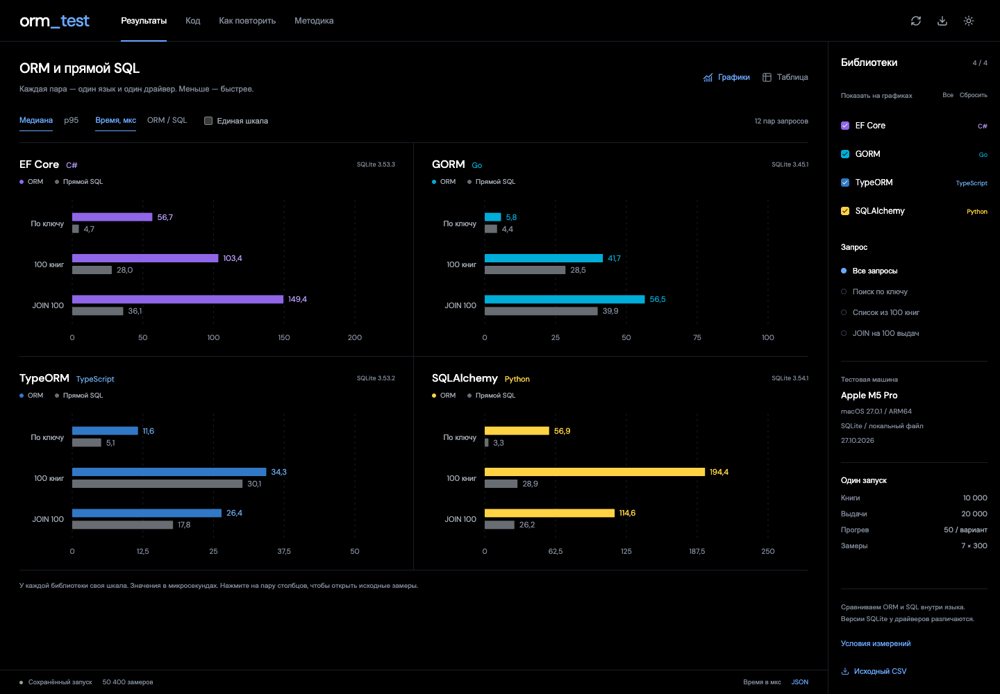
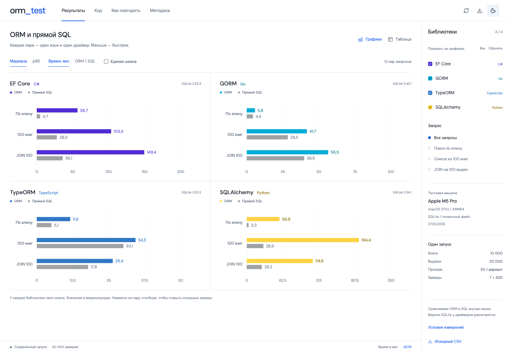
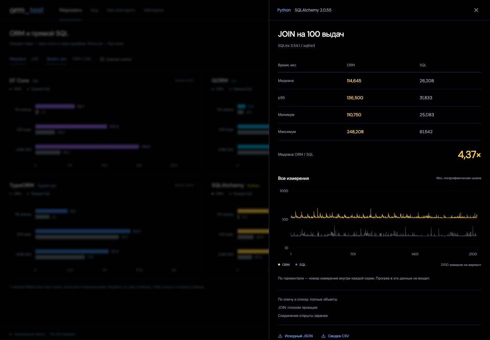

# ORM и прямой SQL

Сравнение EF Core, GORM, TypeORM и SQLAlchemy с прямыми SQL-запросами в тех же языках. В репозитории — четыре небольших проекта, исходные измерения и приложение на Next.js для просмотра результатов.



В приложении можно выбрать библиотеки и запросы, переключить медиану и p95, сравнить время в микросекундах или отношение ORM/SQL, открыть все замеры и выгрузить CSV. В разделе «Код» показаны модели `Book` и `Loan`, подключение SQLite, CRUD и запросы со связью 1:N.

<details>
<summary>Светлая тема</summary>



</details>

<details>
<summary>Подробные измерения одного запроса</summary>



</details>

## Открыть приложение

Для просмотра сохранённых результатов достаточно Node.js 22 или новее. Установка остальных языков и отдельного сервера базы данных не нужна.

```sh
git clone https://github.com/s1ash-cmd/orm_test.git
cd orm_test
npm ci
npm run dev
```

Открыть [localhost:3011](http://localhost:3011). Данные читаются из `benchmark/*.json`, примеры кода — из `projects/`. После новых измерений нажмите кнопку обновления в шапке.

Запуск собранного приложения:

```sh
npm run build
npm start
```

## Повторить измерения

Все команды ниже выполняются из корня репозитория. Нужны Python 3.10+, .NET SDK 10, Go 1.25+, Node.js 22+ и C-компилятор для SQLite-драйвера Go. Версии библиотек закреплены в файлах зависимостей.

| Язык | ORM | Прямой SQL |
| --- | --- | --- |
| C# | EF Core 10.0.14 | Microsoft.Data.Sqlite |
| Go | GORM 1.31.1 | database/sql и go-sqlite3 |
| TypeScript | TypeORM 0.3.31 | better-sqlite3 12.11.1 |
| Python | SQLAlchemy 2.0.55 | sqlite3 из стандартной библиотеки |

### 1. Подготовить Python

```sh
python3 -m venv .venv
.venv/bin/python -m pip install -r projects/python/requirements.txt
.venv/bin/python projects/python/main.py demo
```

В Windows:

```powershell
py -3 -m venv .venv
.venv\Scripts\python.exe -m pip install -r projects/python/requirements.txt
.venv\Scripts\python.exe projects/python/main.py demo
```

### 2. Собрать остальные проекты

```sh
cd projects/csharp
dotnet restore --locked-mode
dotnet build -c Release --no-restore
dotnet run -c Release --no-build -- demo
cd ../..

cd projects/go
go mod download
go build -o ../../benchmark/go-demo .
go run . demo
cd ../..

cd projects/typescript
npm ci
npm run build
npm run demo
cd ../..
```

В Windows укажите в команде сборки Go имя `../../benchmark/go-demo.exe`.

Используйте одну версию Node.js при установке и запуске TypeScript-проекта: `better-sqlite3` содержит нативный модуль. Для Go на Windows нужен C-компилятор с поддержкой CGO, например GCC из MinGW-w64.

<details>
<summary>Go на Apple Silicon при установленной Intel-версии Go</summary>

Из `projects/go`:

```sh
GOARCH=arm64 CGO_ENABLED=1 \
CC='/usr/bin/arch -arm64 /usr/bin/clang' \
go build -o ../../benchmark/go-demo .
```

При одинаковой архитектуре Go и C-компилятора достаточно обычной команды сборки.

</details>

Режим `demo` создаёт локальный `demo.db`, выполняет операции с книгой и выдачей в транзакции и удаляет демонстрационные записи. Переменная `ORM_DB_PATH` задаёт другой путь к базе.

### 3. Запустить общий тест

```sh
.venv/bin/python benchmark/run.py
```

В Windows:

```powershell
.venv\Scripts\python.exe benchmark/run.py --go-binary benchmark/go-demo.exe
```

Скрипт пересоздаёт `benchmark/library.db`, последовательно запускает четыре программы и обновляет JSON с замерами, `summary.csv` и `environment.json`. Другие базы он не пересоздаёт. Собранные программы Go, C# и TypeScript должны быть готовы до запуска.

При нескольких установках Node.js или другом расположении Go-программы пути можно указать явно:

```sh
.venv/bin/python benchmark/run.py --node /path/to/node --go-binary /path/to/go-demo
```

Откройте приложение через `npm run dev` и обновите результаты кнопкой в шапке.

## Как устроено сравнение

В SQLite хранится 10 000 книг и 20 000 выдач. `Loan.book_id` ссылается на `Book.id`; на внешний ключ создан индекс.

| Сценарий | Результат |
| --- | --- |
| Поиск по ключу | Одна книга по `id` |
| Список | 100 книг от заданного `id`, с сортировкой |
| JOIN | 100 выдач с названием книги |

Для каждого сценария и варианта выполняются 50 прогревочных запросов, затем 7 серий по 300 измерений. Прогрев даёт среде выполнения и кэшам выйти на обычный режим; его время не попадает в результат. Всего сохранено 50 400 измерений: 4 языка × 3 сценария × 2 варианта × 2100.

Медиана и p95 считаются по всем 2100 значениям серии, p95 — методом ближайшего ранга. В JSON время хранится в микросекундах в `samples_us`. До замеров результаты ORM и прямого SQL проверяются на совпадение. Порядок вариантов чередуется между сериями.

Соединения открыты заранее. В замер входят создание запроса, чтение и преобразование результата. В EF Core на запрос создаётся `DbContext`, чтение идёт с `AsNoTracking`; в SQLAlchemy создаётся новая `Session`. Поиск и список возвращают объекты с одинаковыми полями, JOIN — плоскую проекцию.

**Сравниваем ORM и SQL внутри одного языка.** Между языками различаются среда выполнения, драйверы и версии SQLite, поэтому эти графики не являются рейтингом ORM. Холодный старт, сеть, запись и конкурентная нагрузка не измерялись.

Сохранённый прогон выполнен 27.10.2026 на Apple M5 Pro, macOS 27.0.1, ARM64. Версии сред: .NET SDK 10.0.403, Go 1.27.3, Node.js 26.12.1, Python 3.14.10. В Go использовалась ARM64-сборка программы. Полные сведения — в [environment.json](benchmark/environment.json), сводка — в [summary.csv](benchmark/summary.csv). На другой машине значения будут отличаться.

## Что лежит в репозитории

| Путь | Содержимое |
| --- | --- |
| `app/`, `components/`, `lib/` | Приложение Next.js, графики, чтение и проверка данных |
| `projects/` | Модели, подключение базы, CRUD, ORM и прямой SQL для четырёх языков |
| `benchmark/` | Подготовка базы, общий запуск, исходные замеры и сводка |
| `diagrams/library.drawio` | Редактируемые UML-диаграммы классов и чтения данных; открыть в draw.io |
| `docs/images/` | Скриншоты приложения для этого README |
| `tests/` | Проверка статистики, данных и поведения интерфейса |

Код использует имена `Book` (книга) и `Loan` (выдача), названия API библиотек и технические ключи JSON. Пояснения, интерфейс и сообщения примеров написаны на русском. Презентация, рабочие черновики, зависимости и сгенерированные базы в репозиторий не входят.

## Проверки

```sh
npm test
npm run typecheck
npm run build
npx playwright install chromium
npm run test:e2e
```

Браузерные сценарии проверяют интерфейс на компьютере и телефоне. Для своего Chromium можно задать `PLAYWRIGHT_CHROMIUM_EXECUTABLE_PATH`.

## Авторы

- [s1ash-cmd](https://github.com/s1ash-cmd)
- [anneett](https://github.com/anneett)
